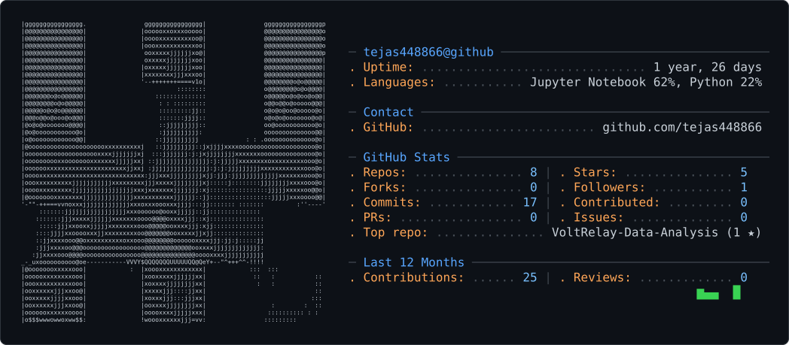

<picture>
  <source media="(prefers-color-scheme: dark)" srcset="dark_mode.svg" />
  <source media="(prefers-color-scheme: light)" srcset="light_mode.svg" />
  
</picture>

<h1 align="center">Hi there, I'm Tejas 👋</h1>

  <strong>AI Systems Engineer & Full-Stack Developer | Computer Vision | 3D Interactive Systems</strong>

  
  
  

---

### 🚀 About Me

I am a passionate software developer and AI enthusiast driven by building intelligent, interactive, and high-performance applications. My work spans across **computer vision-driven interfaces**, **autonomous AI assistants**, **immersive 3D games**, and **algorithmic optimization engines**.

- 🔭 **Currently Building**: Real-time vision-based interactive systems & intelligent decision platforms.
- 💡 **Core Interests**: Computer Vision, Autonomous Agents, 3D Game Engineering, Constraint Optimization.
- 🛠️ **Favorite Stack**: Python, OpenCV, MediaPipe, TypeScript, JavaScript, and Node.js.
- 💬 **Ask me about**: Hand gesture recognition, screen vision analysis, and building interactive web experiences.

---

### 🛠️ Tech Stack & Skills

<table>
  <tr>
    <td align="center" width="120"><strong>Languages</strong></td>
    <td>
      
      
      
      
      
      
    </td>
  </tr>
  <tr>
    <td align="center" width="120"><strong>AI & Vision</strong></td>
    <td>
      
      
      
      
    </td>
  </tr>
  <tr>
    <td align="center" width="120"><strong>Development</strong></td>
    <td>
      
      
      
      
    </td>
  </tr>
</table>

---

### 🌟 Featured Projects

<table>
  <tr>
    <td width="50%" valign="top">
      <h3>🎮 <a href="https://github.com/tejas448866/PalmPilot-AI">PalmPilot-AI</a></h3>
      
An AI-powered real-time hand gesture gaming controller. Uses a standard webcam to detect hand gestures and converts them into in-game actions without a keyboard or gamepad.

      

        
        
        
      

    </td>
    <td width="50%" valign="top">
      <h3>🤖 <a href="https://github.com/tejas448866/AI-VIRTUAL-ASSISTANT">AI-VIRTUAL-ASSISTANT</a></h3>
      
Comprehensive autonomous desktop assistant featuring real-time system monitoring, vision-based screen inspection, automated web browsing, code debugging, and task automation.

      

        
        
        
      

    </td>
  </tr>
  <tr>
    <td width="50%" valign="top">
      <h3>🕹️ <a href="https://github.com/tejas448866/3d-stealth-horror-game-1-">3D Stealth Horror Game</a></h3>
      
Immersive 3D survival game where the player navigates an eerie abandoned environment, solves complex environmental puzzles, bypasses patrol enemies, and executes stealth escapes.

      

        
        
        
      

    </td>
    <td width="50%" valign="top">
      <h3>📅 <a href="https://github.com/tejas448866/Smart-Timetable-Optimization">Smart Timetable Optimization</a></h3>
      
Intelligent constraint optimization engine that generates conflict-free schedules across instructors, classrooms, student batches, and curriculum requirements.

      

        
        
      

    </td>
  </tr>
  <tr>
    <td width="50%" valign="top">
      <h3>📈 <a href="https://github.com/tejas448866/artifacts">Financial Decision Engine</a></h3>
      
AI-based business and financial decision optimization engine providing structured constraint analysis and predictive optimization models.

      

        
        
      

    </td>
    <td width="50%" valign="top">
      <h3>⚡ <a href="https://github.com/tejas448866/VoltRelay-Data-Analysis">VoltRelay Data Analysis</a></h3>
      
Exploratory data analysis, statistical modeling, and telemetry trend visualization using Jupyter notebooks and data science libraries.

      

        
        
      

    </td>
  </tr>
</table>

---

### 📊 GitHub Activity & Statistics

  
  

  

---

### 🤝 Connect With Me

  
  

  Generated with ❤️ for <a href="https://github.com/tejas448866">tejas448866</a> using gh-ascii retro profile card.

